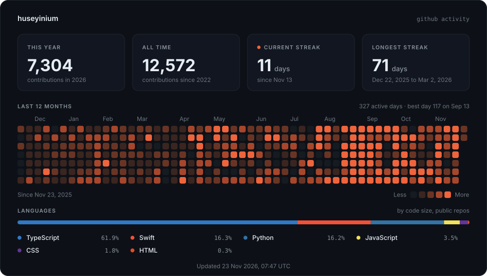

  

  
  
  

### About

I build products end to end, from the database schema to the last pixel. Right now that is
**[ARCY AI](https://arcyai.com)**: an agent that lives inside a software product, answers
customers right where they get stuck, and shows the team where people quietly drop off.

Before that I shipped small tools I wanted for myself, and I still do.

### Things I've made

| Project | What it is | Built with |
| --- | --- | --- |
| [**ARCY AI**](https://arcyai.com) | An in-product AI agent that answers customers inside the product and shows where they drop off | TypeScript, Next.js, NestJS |
| [**hushboard**](https://github.com/huseyinium/hushboard) | A macOS menu bar app that mutes your mic while you type in meetings | Swift |
| [**unREADME**](https://github.com/huseyinium/unREADME) | An npm package that writes a solid README with one command | JavaScript |
| [**huseyinium.com**](https://huseyinium.com) | My personal site | TypeScript |

### Tools I reach for

**Languages** &nbsp;

**Frontend** &nbsp;

**Backend** &nbsp;

**Cloud** &nbsp;

### Activity

  

The card above redraws itself every 6 hours with a GitHub Action in this repo.

